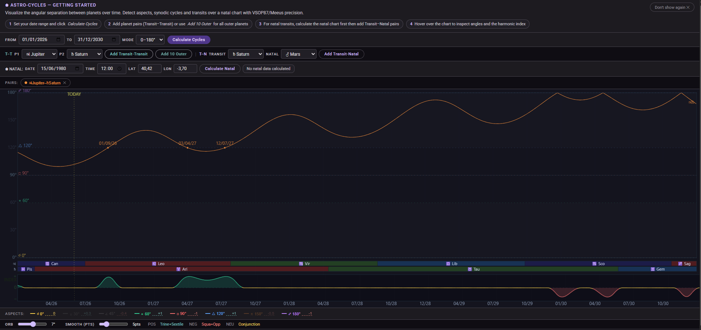

# 🌌 Astro-Cycles

🔭 **[Live Demo](https://fransolerc.github.io/astro-cycles)** · Astronomical cycle calculator and visualizer · JPL Keplerian elements (1800–2050)



---

[**Español**](#-español) | [**English**](#-english)

---

## 🇺🇸 English

Astro-Cycles visualizes the angular separation between planets over time. Detect conjunctions, oppositions and other aspects, track synodic cycles, and overlay a harmonic index — all in the browser, no server required.

### ✨ Features

- **Transit–Transit (T-T):** Angular separation between any two planets across a date range.
- **Transit–Natal (T-N):** Transits against a custom birth chart.
- **Harmonic Index:** Configurable scoring of global tension/harmony based on active aspects and orbs. It is a heuristic with arbitrary weights, not an empirically validated model.
- **Sign Timeline:** Color-coded band showing which zodiac sign each planet occupies, with element grouping (Fire/Earth/Air/Water).
- **Planet Positions:** Sign, degree and retrograde status of all ten planets at any date, independent of the active pairs and aspects. Follows the cursor over the chart; click to pin a date.
- **Interactive Tooltip:** Hover or touch to inspect angles, sign positions, and the harmonic index at any point in time.
- **Highly Configurable:** Adjust orbs, smoothing, display mode (0–180° / 0–360°), and aspect weights.
- **Mobile Optimized:** Responsive layout with touch support.

### 🛠️ Stack

Vanilla JavaScript (ES6+) · HTML5 Canvas · CSS3 — no frameworks, no build step, no dependencies.

Astronomy engine: JPL Keplerian elements for the planets, referred to the equinox of date, plus low-precision analytical formulas for the Sun and the Moon. See *Accuracy* below.

### 📐 Accuracy

| Body | Source | Error |
|---|---|---|
| Mercury–Mars, Uranus, Neptune | JPL Keplerian elements (Standish, Table 1) | ≤ 50″ in heliocentric longitude (nominal) |
| Jupiter, Saturn | same | 400″ / 600″ ≈ 0.11° / 0.17° (nominal) |
| Sun | Meeus, low-accuracy formula (ch. 25) | ≈ 0.01° (nominal) |
| Moon | short truncated series | low precision |
| Pluto | separate element set | ≈ 0.02° measured at 8 sign ingresses in 2008–2024; unchecked elsewhere |

- The JPL elements are fitted for **1800–2050**. Outside that range, accuracy degrades, and the status bar says so.
- Positions are geometric: no nutation, aberration or light-time correction (together ≲ 0.02°).
- The natal time is read as **UT**; no timezone conversion is applied.
- Source of the planetary elements: [Approximate Positions of the Planets](https://ssd.jpl.nasa.gov/planets/approx_pos.html), JPL Solar System Dynamics.

### ⚙️ Setup

Static app — no server needed:

```
git clone https://github.com/fransolerc/astro-cycles
open index.html
```

Or use the **[Live Demo](https://fransolerc.github.io/astro-cycles)** directly.

---

## 🇪🇸 Español

Astro-Cycles visualiza la separación angular entre planetas a lo largo del tiempo. Detecta conjunciones, oposiciones y otros aspectos, sigue ciclos sinódicos y superpone un índice armónico — todo en el navegador, sin servidor.

### ✨ Características

- **Tránsitos Planetarios (T-T):** Separación angular entre cualquier par de planetas en un rango de fechas.
- **Tránsitos Natales (T-N):** Tránsitos sobre una carta natal personalizada.
- **Índice Armónico:** Puntuación configurable de tensión/armonía global basada en aspectos activos y orbes. Es una heurística con pesos arbitrarios, no un modelo validado empíricamente.
- **Timeline de Signos:** Banda con código de color mostrando en qué signo se encuentra cada planeta, agrupado por elemento (Fuego/Tierra/Aire/Agua).
- **Posiciones Planetarias:** Signo, grado y retrogradación de los diez planetas en cualquier fecha, independientes de los pares y aspectos activos. Sigue al cursor sobre el gráfico; un click fija la fecha.
- **Tooltip Interactivo:** Hover o toque para inspeccionar ángulos, posiciones en signo e índice armónico en cualquier punto temporal.
- **Altamente Configurable:** Ajuste de orbes, suavizado, modo de visualización (0–180° / 0–360°) y pesos de aspecto.
- **Optimizado para Móvil:** Interfaz adaptativa con soporte táctil.

### 🛠️ Stack

Vanilla JavaScript (ES6+) · HTML5 Canvas · CSS3 — sin frameworks, sin build step, sin dependencias.

Motor astronómico: elementos keplerianos de JPL para los planetas, referidos al equinoccio de la fecha, más fórmulas analíticas de baja precisión para el Sol y la Luna. Ver *Precisión* más abajo.

### 📐 Precisión

| Cuerpo | Fuente | Error |
|---|---|---|
| Mercurio–Marte, Urano, Neptuno | Elementos keplerianos de JPL (Standish, Tabla 1) | ≤ 50″ en longitud heliocéntrica (nominal) |
| Júpiter, Saturno | ídem | 400″ / 600″ ≈ 0,11° / 0,17° (nominal) |
| Sol | Meeus, fórmula de baja precisión (cap. 25) | ≈ 0,01° (nominal) |
| Luna | serie truncada corta | baja precisión |
| Plutón | conjunto de elementos propio | ≈ 0,02° medido en 8 ingresos de signo de 2008–2024; sin comprobar fuera de ese rango |

- Los elementos de JPL están ajustados para **1800–2050**. Fuera de ese rango, la precisión se degrada, y la barra de estado lo avisa.
- Las posiciones son geométricas: sin corrección de nutación, aberración ni tiempo de luz (en conjunto ≲ 0,02°).
- La hora natal se interpreta como **UT**; no se aplica ninguna conversión de zona horaria.
- Fuente de los elementos planetarios: [Approximate Positions of the Planets](https://ssd.jpl.nasa.gov/planets/approx_pos.html), JPL Solar System Dynamics.

### ⚙️ Ejecución

Aplicación estática — no requiere servidor:

```
git clone https://github.com/fransolerc/astro-cycles
open index.html
```

O usa la **[Demo en Vivo](https://fransolerc.github.io/astro-cycles)** directamente.
